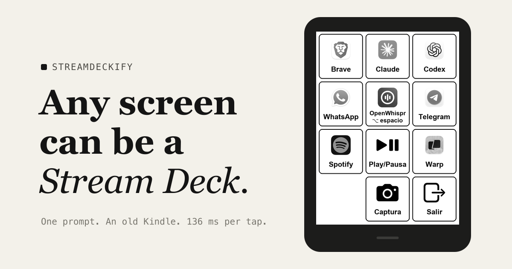

<p align="center">
  <a href="https://streamdeckify.org"></a>
</p>

<h1 align="center">Streamdeckify</h1>

<p align="center"><b>Any screen can be a Stream Deck.</b><br>
One prompt for your AI coding agent turns an old Kindle, tablet, phone or TV into a button panel for your computer.<br>
Free, open source, nothing in the cloud.</p>

<p align="center">
  <a href="https://streamdeckify.org">Website</a> ·
  <a href="prompts/kindle.md">Kindle prompt</a> ·
  <a href="prompts/any-screen.md">Any other screen</a> ·
  <a href="CONTRIBUTING.md">Add your device</a>
</p>

## Why

My Kindle Paperwhite is from 2013. The battery is tired and I read on my phone these days, so it was headed for a drawer. One night I asked Claude Code to turn it into a Stream Deck for my Mac. We jailbroke it together, step by step, and it wrote a little server for the Mac and a client for the Kindle. Now it sits under my monitor opening apps, starting dictation and pausing the music, 136 ms after I tap it.

This repo is that prompt, cleaned up so anyone can do the same with whatever screen they have lying around. And because every screen is different, the list of devices is written by the people who got theirs working.

## Quick start

You need a computer, the screen you want to use (on the same Wi-Fi), and a coding agent that can run commands: Claude Code, Codex, Gemini CLI or similar.

| Step | What to do |
| --- | --- |
| **1. Pick a prompt** | [Kindle](prompts/kindle.md) (best: full screen, instant taps), [Kindle without jailbreak](prompts/kindle-no-jailbreak.md) (uses its web browser) or [any other screen](prompts/any-screen.md) (tablets, phones, TVs, touch or not). |
| **2. Paste it into your agent** | It asks what you have, then builds everything with you and explains each step before taking it. |
| **3. Tap** | Open apps, press shortcuts, pause music, switch scenes, turn on the lights. |

Or just paste this one line, which fetches the latest version of the recipe:

```text
Turn my Kindle into a Stream Deck for this computer. Fetch https://streamdeckify.org/prompts/kindle.md and follow it step by step. Explain each step and ask me before changing anything.
```

## How it works

```text
 old screen  ── Wi-Fi + token ──▶  your computer  ──▶  the action
 shows the panel,                  tiny server with     app, shortcut,
 reports where you tap             a fixed action list  music, lights
```

- The computer does the work: it draws the panel, keeps the list of buttons and runs the actions.
- The screen only shows the panel and says where you tapped. It never sends commands.
- Everything stays on your local network, behind a random token. No accounts, no cloud, no telemetry.
- Nothing is permanent. Exit the panel and your device is back to normal.

## Devices

Every device has its own page with what worked, what didn't and how fast it is: [src/content/devices](src/content/devices) (and on the website).

| Device | Status | How | Tap to action |
| --- | --- | --- | --- |
| [Kindle Paperwhite 2 (2013)](src/content/devices/kindle-paperwhite-2.md) | verified | jailbreak + KOReader's LuaJIT | 136 ms |

Wanted, be the first: Kindle 4 or Kindle Keyboard (no touch, 5-way pad), Kobo, old iPads, Android phones and tablets, Android TV with the remote, a Raspberry Pi with a screen, and yes, a Steam Deck.

## Contributing

The whole website is built from this repo, so a merged pull request goes live by itself.

- **Show your deck**: a photo and three lines in `src/content/decks/`. Or [open an issue](../../issues/new?template=share-deck.yml) and we'll add it for you.
- **Add a device**: one Markdown file in `src/content/devices/`. CI checks every field.
- **Improve a prompt**: the recipes in `prompts/` are the product. Tell us which device you tested on.

Details in [CONTRIBUTING.md](CONTRIBUTING.md). Run the site locally with `npm install && npm run dev`.

## Is this the Elgato Stream Deck?

No. Streamdeckify is an independent community project, not affiliated with, endorsed by or sponsored by Elgato or Corsair. Stream Deck is a trademark of Corsair Memory, Inc., and Kindle is a trademark of Amazon.com, Inc. or its affiliates. The names only describe what you end up with. If you have a concern, legal or otherwise, write to the address on the website and we'll answer quickly.

Jailbreaking can void your warranty and carries some risk. The prompts back up your device first and only follow the community's official guides at [kindlemodding.org](https://kindlemodding.org). This repo never hosts jailbreak files.

## License

[MIT](LICENSE). Use it, fork it, build things with it.
